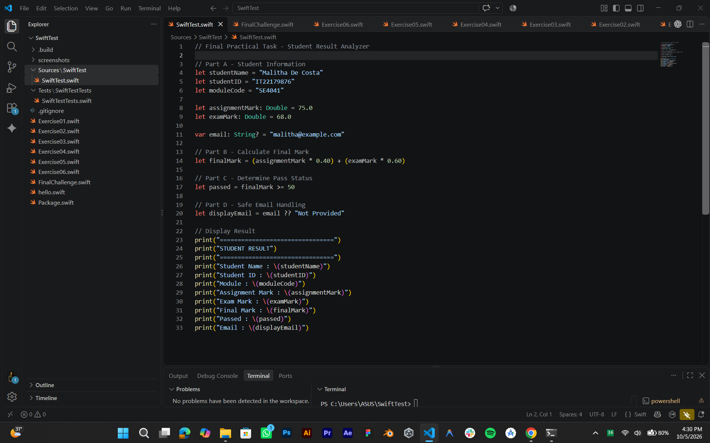
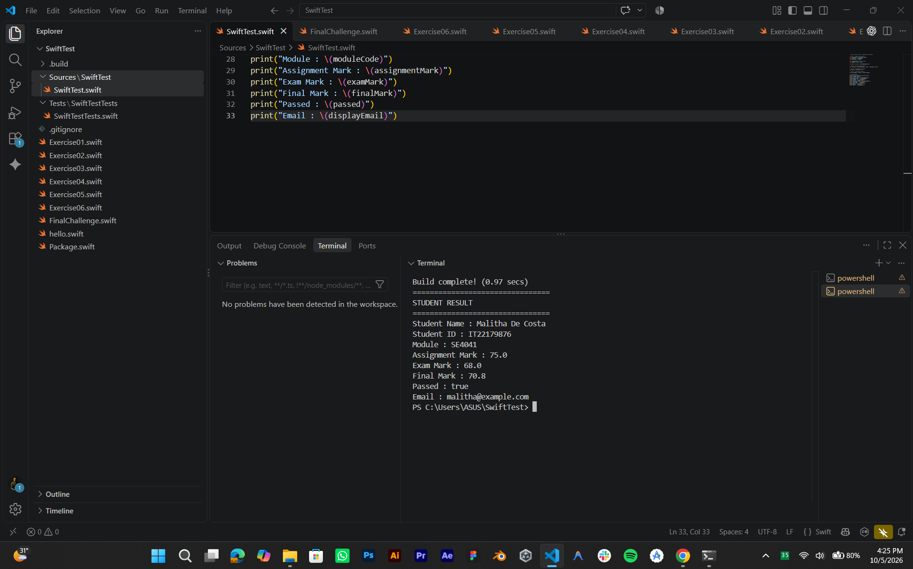
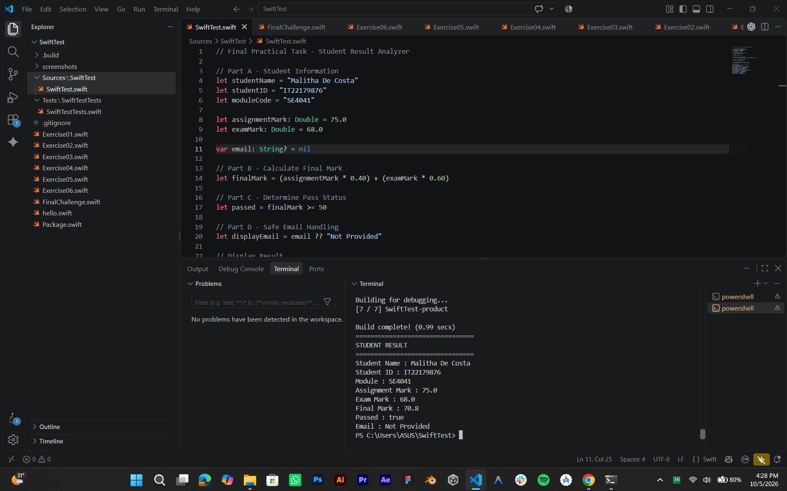

# SE4041 Practical 01 - Swift Fundamentals

## Student Details

Name: Malitha De Costa  
Student ID: IT22179876  
Module: SE4041 - Mobile Application Design and Development  
Practical: Practical 01 - Swift Fundamentals  
Environment: Swift 6.4 on Windows with Visual Studio Code

## My Practical Evidence

